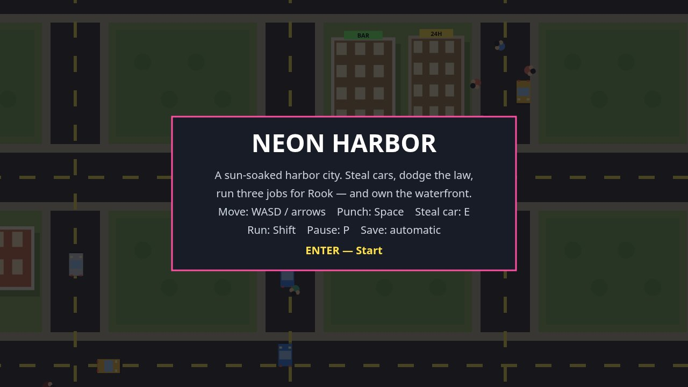
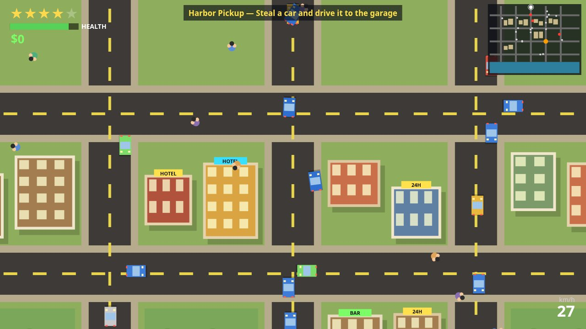
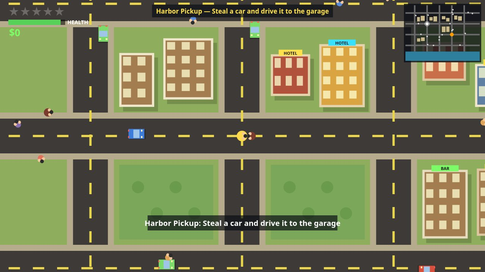
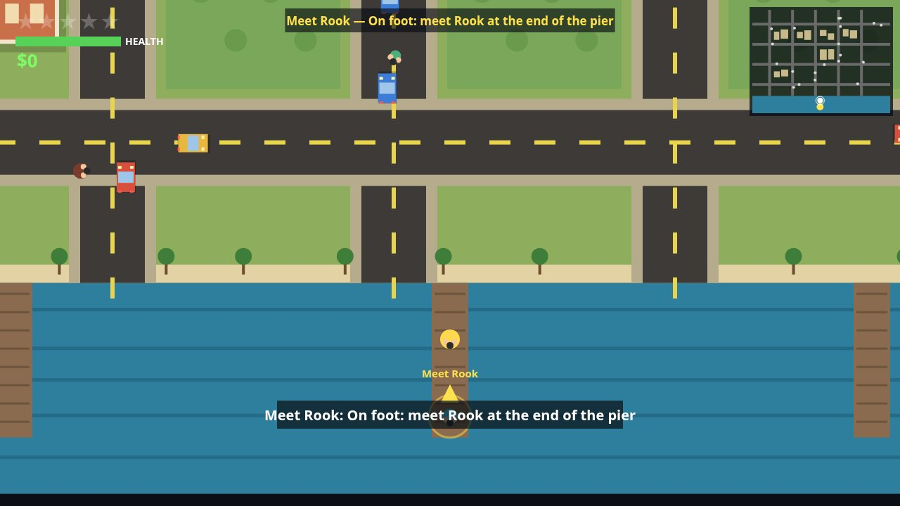

# Neon Harbor

[](https://make.fun/bounty/gta6-01)
[](https://make.fun/bounty/gta6-01)
[](https://make.fun/bounty/gta6-01)

A top-down open-world crime game for the [Make GTA 6 bounty](https://make.fun/bounty/gta6-01) on make.fun — a fictional harbor city you can walk and drive, in the spirit of GTA 6. Everything in it is original: the city, the characters, the story, the art and the sound. No Rockstar names, art or music.

## Play

Open `game/index.html` in a desktop browser, or serve it locally:

```sh
node serve.ts
# then open http://localhost:8080
```

No build step, no install, no network request — the game is plain static files under `game/`.

### Controls

| Key | Does |
| --- | --- |
| W A S D / arrows | Walk · drive |
| Shift | Run |
| E | Steal a car / get out |
| Space | Punch |
| P / Esc | Pause |
| Enter | Start · continue |
| N | New game (from the title screen) |

### The city

- **Walk and drive** a 2400×1800 harbor city: five avenues, four cross streets, a waterfront promenade and a pier.
- **Traffic and pedestrians** fill the streets; cars stop for nothing and pedestrians flee from a speeding car.
- **Steal any car** with E — the cops notice, and your wanted level rises.
- **Wanted system and police**: up to five stars, police cars that chase and ram you, and a Busted screen if they catch you on foot.
- **Three missions** from fixer Marina: drive her car to the garage, meet Rook at the end of the pier, then lose a three-star tail at the east gate. Each pays cash.
- **Combat**: thugs roam the streets and swing at you; knock one down for $25.
- **HUD with minimap**: health, cash, wanted stars, mission objective, and a live minimap with the mission marker.
- **Save**: cash and mission progress save in your browser (localStorage) and can be continued from the title screen.
- **Sound**: procedural WebAudio — engine, sirens, punches, pickups and mission stings. No audio files.

## Screenshots






The screenshots are real frames of the game, staged by `game/src/shots.js` from `shots.json` (`?shot=start|play|end|pickup&seed=1`).

## Build the dossier

```sh
mkdir -p out && MAKEFUN_OUTPUT_DIR=out node main.ts
# writes out/dossier.json (makefun/dossier/v1) from game/ and screenshots/
```

`main.ts` is the entrypoint (Node 22, standard library only). The dossier is built with the vendored make.fun library in `vendor/makefun-game.ts`.

## Entry

Built for the **Make GTA 6** bounty (`gta6-01`) on make.fun — $1,666 total prize, entries close 2026-11-24.

- Bounty: https://make.fun/bounty/gta6-01
- Invite code: `efr46sz5` — https://make.fun/r/efr46sz5

## License

MIT — see [LICENSE](LICENSE).
